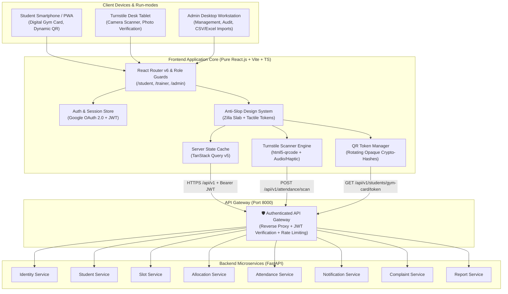

# 01. Frontend Architecture & Technical Specifications

**Version:** 1.0  
**Status:** Approved Technical Architecture  
**Target Platform:** Web (Desktop, Tablet, Mobile) + Progressive Web App (PWA)

---

## 1. Executive Architecture Overview

The **GymSlot** frontend serves four distinct user personas (**Students**, **Trainers / Gym Staff**, **Sports Administrators**, and **System Administrators**) across SRM University-AP's campus fitness facilities.

The frontend operates as a decoupled client layer that communicates with backend services exclusively through an authenticated **API Gateway** running at `/api/v1`. The backend is powered by **Python 3.11+ / FastAPI** microservices with PostgreSQL databases per service, transactional outbox event messaging, and S3-compatible private object storage.



---

## 2. Technology Stack & Decision Rationale

| Category | Recommended Stack | Production Rationale |
| :--- | :--- | :--- |
| **Framework** | **React.js 18+ (SPA with Vite)** | **Pure React.js single-page application with React Router v6.** Maximizes build speed, eliminates SSR node server dependencies, enables instant client navigation, and compiles to lightweight static files served directly by Nginx or S3/CloudFront. |
| **Language** | **TypeScript 5.x** | Strict typing across all API payloads, domain events, form schemas, and user roles prevents runtime errors. |
| **Styling & CSS** | **Vanilla CSS Tokens + CSS Modules** | High aesthetic fidelity without framework bloat. Adheres strictly to the `page-is-the-object` tactile design system, fluid `clamp()` type scaling, and zero-slop layout rules. |
| **Server State** | **TanStack Query v5** | — | Built-in caching, background revalidation, optimistic updates for slot booking and transfer requests, and automatic deduplication. |
| **Client State** | **Zustand** | — | Lightweight store for active session tokens, sidebar collapse states, turnstile camera device IDs, and ephemeral modal states. |
| **Form Management** | **React Hook Form + Zod** | — | Type-safe schema validation matching backend Pydantic v2 schemas; minimal re-renders on dense administrative forms. |
| **QR Generation** | **qrcode.react** / **canvas** | — | Client-side vector and canvas rendering of high-entropy opaque hash tokens with zero latency. |
| **QR Scanning** | **html5-qrcode** | Native BarcodeDetector API | High compatibility across iOS Safari, Android Chrome, and desk tablets; handles camera switching and continuous scanning. |
| **Data Tables** | **TanStack Table v8** | — | Headless, highly performant virtualization for large attendance logs, waitlists, and student rosters without sluggish generic styling. |
| **Icons & Media** | **Custom SVG Glyphs** | Lucide Icons (curated) | Clean, geometric, non-emoji vector graphics matching academic and athletic aesthetic. |

---

## 3. Directory & Module Organization

The project follows a feature-driven, role-segregated architecture designed for maintainability and clear team boundaries:

```text
frontend/
├── public/
│   ├── assets/                 # Curated CC-licensed photography
│   │   ├── credits.json        # Open-access attribution catalog
│   │   └── *.jpg               # High-resolution athletic imagery
│   ├── favicon.ico
│   ├── manifest.json           # Progressive Web App manifest
│   └── sw.js                   # Service worker for offline gym card caching
├── src/
│   ├── pages/                  # React Router v6 Page Routes
│   │   ├── public/             # Public routes
│   │   │   ├── LandingPage.tsx # Anti-slop landing page
│   │   │   ├── Login.tsx       # Google OAuth initiation
│   │   │   └── AuthCallback.tsx# OAuth redirect handler
│   │   ├── student/            # Student Portal screens
│   │   │   ├── Onboarding.tsx  # Verified student details & status
│   │   │   ├── Dashboard.tsx   # Allocation overview & streak
│   │   │   ├── QRCodePage.tsx  # Student QR code (AP#, email, date, time)
│   │   │   ├── SlotBrowser.tsx # Available slots & waitlists
│   │   │   ├── SlotTransfer.tsx# Protected slot transfer engine
│   │   │   ├── Attendance.tsx  # History & absence barometer
│   │   │   └── Complaints.tsx  # Support tickets
│   │   ├── staff/              # Gym Staff / Trainer screens
│   │   │   ├── QRScannerPage.tsx# Camera QR scanner
│   │   │   ├── ManualCheckInPage.tsx# Fallback AP number lookup
│   │   │   └── SessionRosterPage.tsx# Real-time session roster
│   │   ├── admin/              # Sports Administrator screens
│   │   │   ├── AdminDashboard.tsx
│   │   │   ├── FacilitiesPage.tsx# Gyms, slots, schedules
│   │   │   ├── RegistrationWindowsPage.tsx
│   │   │   ├── TransfersPage.tsx # Transfer reviews
│   │   │   ├── AttendanceAuditPage.tsx# Audit & correction modal
│   │   │   ├── AbsenceMonitorPage.tsx # Retention & reclamation
│   │   │   ├── ComplaintsPage.tsx # Staff assignment & triage
│   │   │   ├── BulkImportPage.tsx # Excel slot & student import
│   │   │   └── ReportsExportPage.tsx # CSV/Excel analytics export
│   │   └── super-admin/        # System Admin screens
│   │       ├── StaffManagementPage.tsx # Staff role provisioning
│   │       ├── SystemSettingsPage.tsx  # College domain & config
│   │       └── AuditTrailPage.tsx      # Append-only audit logs
│   ├── components/             # Reusable UI component library
│   │   ├── ui/                 # Atomic design tokens (button, input, badge)
│   │   ├── feedback/           # Alert boxes, toasts, modals
│   │   ├── qr/                 # Student QR code display component
│   │   ├── scanner/            # Camera scanner viewport & verification card
│   │   ├── tables/             # Headless virtualized table components
│   │   └── layout/             # Masthead, role navigations, footers
│   ├── hooks/                  # Custom React hooks
│   │   ├── useAuth.ts          # Session, user profile, role checks
│   │   ├── useQRScanner.ts     # Camera lifecycle & scan handler
│   │   └── useDebounce.ts      # Input debounce for search & filters
│   ├── lib/                    # Core utilities & API clients
│   │   ├── api-client.ts       # Typed Axios wrapper with interceptors
│   │   ├── endpoints.ts        # Centralized REST endpoint catalog
│   │   ├── tokens.ts           # Token storage & expiry helpers
│   │   └── formatters.ts       # Date, time, AP number, capacity formatters
│   ├── styles/                 # Design system stylesheets
│   │   ├── tokens.css          # Color, typography, fluid clamps
│   │   ├── reset.css           # Modern box-sizing reset
│   │   └── globals.css         # Utility classes, animation layers
│   └── types/                  # TypeScript interface declarations
│       ├── api.ts              # Request/response envelope types
│       ├── student.ts          # Student profile, allocation, QR
│       ├── slot.ts             # Gyms, slots, schedules, capacity
│       ├── attendance.ts       # Sessions, logs, corrections
│       └── complaints.ts       # Tickets, status, comments
├── Dockerfile                  # Multi-stage production container (Nginx)
├── nginx.conf                  # Production reverse proxy config
├── tsconfig.json
└── package.json
```

---

## 4. Authentication, Authorization & Session Lifecycle

Authentication strictly follows Google OAuth 2.0 / OpenID Connect restricted to approved institutional domains (`@srmap.edu.in`).

```mermaid
sequenceDiagram
    autonumber
    actor Student as Student Browser
    participant FE as GymSlot Frontend (React)
    participant Google as Google Identity Services
    participant GW as API Gateway (:8000)
    participant Auth as Identity Service

    Student->>FE: Click "Continue with SRM-AP Google Account"
    FE->>Google: Redirect to OAuth 2.0 Consent Screen
    Google-->>Student: Prompt for @srmap.edu.in account
    Student->>Google: Authenticate & Consent
    Google-->>FE: Redirect to /auth/callback?code=AUTH_CODE
    FE->>GW: POST /api/v1/auth/google/callback { code }
    GW->>Auth: Exchange code with Google & verify email domain
    Note over Auth: Verify provisioned account status & user roles
    Auth-->>GW: Issue Access Token (JWT, 60m) + HttpOnly Refresh Cookie
    GW-->>FE: Return { access_token, user: { id, name, role, ap_number } }
    FE->>FE: Store access_token in Memory / AuthState; redirect by role
    FE->>Student: Render role portal (/student/dashboard or /admin)
```

### Role-Based Route Guards (RBAC)
Routes are protected by a client-side React Router guard with strict fallback handling:
- **`STUDENT`**: Restricted to `/student/*`. Attempts to access `/staff/*` or `/admin/*` trigger a `403 Forbidden` slate.
- **`TRAINER` / `STAFF`**: Restricted to gym staff scanner (`/staff/*`) and personal profile.
- **`ADMIN`**: Access to sports administration (`/admin/*`), slots, attendance audits, and reporting.
- **`SUPER_ADMIN`**: Full platform authority including staff grants (`/super-admin/*`) and institutional configuration.

### Session Expiry & Token Refresh
1. Access tokens are short-lived (60 minutes).
2. The Axios client intercepts outgoing requests:
   ```typescript
   // lib/api-client.ts
   apiClient.interceptors.response.use(
     (response) => response,
     async (error) => {
       const originalRequest = error.config;
       if (error.response?.status === 401 && !originalRequest._retry) {
         originalRequest._retry = true;
         try {
           const { data } = await axios.post('/api/v1/auth/refresh');
           setAccessToken(data.access_token);
           originalRequest.headers.Authorization = `Bearer ${data.access_token}`;
           return apiClient(originalRequest);
         } catch (refreshErr) {
           clearSession();
           window.location.href = '/login?expired=1';
           return Promise.reject(refreshErr);
         }
       }
       return Promise.reject(error);
     }
   );
   ```

---

## 5. State Management & Server Synchronization

### 5.1 TanStack Query Server State Cache
All server data uses structured cache keys to support deterministic invalidation:

| Query Key Pattern | Cache Duration (`staleTime`) | Revalidation Trigger |
| :--- | :--- | :--- |
| `['student', 'profile']` | 15 minutes | Account update |
| `['student', 'allocation']` | 1 minute | Allocation transfer, window change |
| `['student', 'qr']` | 30 seconds | Session selection, slot change |
| `['slots', 'facilities']` | 5 minutes | Slot update, window status change |
| `['slots', 'available', gymId]` | 15 seconds | Slot application, waitlist promotion |
| `['attendance', 'history']` | 2 minutes | Check-in event, admin correction |
| `['admin', 'transfers']` | 30 seconds | Admin review action |
| `['admin', 'complaints']` | 1 minute | Ticket creation, comment post |

### 5.2 Optimistic Updates for High-Contention Actions
When students apply for high-demand slots or request transfers, the UI immediately reflects the local status update with a rollback fallback if the backend serializable capacity constraint fails:
```typescript
const queryClient = useQueryClient();

const applySlotMutation = useMutation({
  mutationFn: (slotId: string) => api.post(`/api/v1/applications`, { slot_id: slotId }),
  onMutate: async (newSlotId) => {
    await queryClient.cancelQueries({ queryKey: ['student', 'application'] });
    const previousState = queryClient.getQueryData(['student', 'application']);
    queryClient.setQueryData(['student', 'application'], {
      slot_id: newSlotId,
      status: 'PENDING_CONFIRMATION',
    });
    return { previousState };
  },
  onError: (err, newSlotId, context) => {
    queryClient.setQueryData(['student', 'application'], context?.previousState);
    toast.error('Slot capacity filled. Placed in FCFS waitlist queue.');
  },
  onSettled: () => {
    queryClient.invalidateQueries({ queryKey: ['slots', 'available'] });
  },
});
```

---

## 6. Student QR Code Architecture

### 6.1 QR Payload Specification
Per the updated requirements:
- The QR code is generated for students who have an active gym allocation.
- **QR Payload Fields:**
  1. Student AP number (e.g. `AP21110010123`)
  2. College email (e.g. `aarav_raj@srmap.edu.in`)
  3. Session date (e.g. `2026-10-28`)
  4. Slot timing (e.g. `17:45 - 18:45`)
- Displayed alongside the QR code: AP number, college email, slot timing, and session date.
- Rendered using `qrcode.react`.
- **Validation Principle:** The QR data is treated as untrusted input by the backend. When scanned by staff, the backend validates the payload against authoritative student, allocation, gym, and session records before recording attendance.
- **PWA Security:** Do not cache QR codes or sensitive student information for offline use.

---

## 7. Gym Staff QR Scanner Engine (`html5-qrcode`)

The staff scanner operates on mobile devices and desk tablets via `html5-qrcode`:
- Camera selection and flashlight toggle where supported.
- Scans QR payload containing AP number, college email, session date, and slot timing.
- Transmits scanned payload to `POST /api/v1/attendance/scan`.
- **Multi-Point Verification Overlay:**
  1. Student Name and AP Number from official record.
  2. College Email.
  3. Assigned Gym and Slot Timing (verified from official allocation).
  4. Session Date and Attendance Status.
  5. Action buttons: `[CONFIRM ENTRY]` and `[REJECT]`.
- **Server-Side Exception Guards:**
  - Reject unknown AP number or AP/email mismatch.
  - Reject inactive allocation, wrong gym/slot, or wrong session date.
  - Show clear `Already Checked In` message for duplicate scans.
- **Manual Fallback:** Authorized AP number lookup when the camera or student phone is unavailable.

---

## 8. Security & Compliance Checklist

- **No Local Storage of Secrets:** Access tokens reside in application memory; refresh tokens reside in `HttpOnly, Secure, SameSite=Strict` cookies.
- **Content Security Policy (CSP):** Script sources restricted to `'self'`; connect sources locked to `/api/v1` and Google OAuth endpoint.
- **Camera Permissions:** Explicitly declared in HTML header via `Permissions-Policy: camera=(self)`.
- **Zero In-Line Styles in Production:** All styles emitted via class names and CSS variables.
