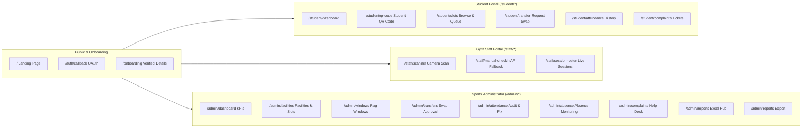

# 03. Screens & User Workflows Specification

**Version:** 1.0  
**Status:** Complete Functional Specification  
**Coverage:** Public Onboarding, Student Portal, Trainer Scanner, Sports Admin Dashboard, Super Admin

---

## 1. Overview of Portals & Screen Map

---

## 2. Public & Pre-Authentication Screens

### 2.1 Landing Page (`/`)
- **Visual Identity:** Tactile stationery with collegiate athletic green folder hero, tabbed gym facilities (C. V. Raman, Ganga, Krishna, Narmada), and live rotating QR digital gym pass simulator.
- **Primary CTA:** Single high-contrast button: `Continue with SRM-AP Google Account`.
- **Secondary Actions:** `View Official Timetable`, `Campus Access Itinerary`, `FAQ Accordion`.
- **Footer:** Formal institutional mark: *Department of Physical Education & Sports Facilities, SRM University-AP*, with open-license picture attributions.

### 2.2 Student Profile Onboarding (`/onboarding`)
- **Trigger:** First-time login by a provisioned student after Google OAuth authentication.
- **Displayed Details:**
  - Read-only official identity fields from the verified student record: Student Full Name, AP Number, and College Email.
  - Active Allocation Status indicator: Displays whether the student currently holds an active gym allocation or needs to apply during an open registration window.
  - Guidance Notice: If student data cannot be matched against provisioned institutional records, displays a clear prompt: *"Student record not found. Please contact the Sports Department with your AP Number."*

---

## 3. Student Portal Screens (`/student/*`)

### 3.1 Student Dashboard (`/student/dashboard`)
- **Hero Summary Card:**
  - Displays current active slot: e.g., **C. V. Raman Central Complex · 17:45 – 18:45**.
  - One-tap button: `View Turnstile Pass` (opens Student QR Code page).
  - Quick status badge: `ACTIVE`, `TRANSFER_REQUESTED`, or `WAITLISTED (#3 in queue)`.
- **Attendance & Absence Barometer:**
  - Weekly streak counter (e.g., `4 of 5 sessions attended this week`).
  - **Absence Risk Gauge:**
    - `0–1 Absences`: Neutral green meter (*"Attendance in good standing"*).
    - `2 Absences`: Amber indicator (*"Warning: 2 unexcused absences"*).
    - `3 Absences`: Red striped indicator (*"Critical Warning: 1 absence away from automated slot reclamation"*).
    - `4 Absences`: Danger slate (*"Allocation terminated due to policy threshold"*).
- **Recent Announcements Carousel:**
  - Important notices published by Sports Administration (e.g., *"C. V. Raman closed on Saturday for Inter-University Badminton"*).

### 3.2 Student QR Code Display (`/student/qr-code`)
- **Access Rule:** Available to students who have an active gym allocation for the selected or upcoming session.
- **QR Payload Fields (Encodes 4 core verification attributes):**
  1. Student AP number (e.g. `AP21110010123`)
  2. College email (e.g. `aarav_raj@srmap.edu.in`)
  3. Session date (e.g. `2026-10-28`)
  4. Slot timing (e.g. `17:45 - 18:45`)
- **Card Presentation:**
  - Displays AP number, college email, slot timing, and session date cleanly alongside the QR graphic.
  - Rendered client-side via `qrcode.react`.
- **Backend Validation Principle:** The QR payload is treated as untrusted input. When scanned at the turnstile desk, the backend verifies all four fields against authoritative student, allocation, gym, and session records before recording attendance.
- **PWA Security:** Do not cache QR codes or sensitive student information for offline use.

### 3.3 Available Slot Browser & FCFS Application (`/student/slots`)
- **Facility Tab Navigation:**
  - Tabs: `C. V. Raman`, `Ganga (Girls)`, `Krishna (Boys)`, `Narmada (Dedicated)`.
- **Slot Time Cards:**
  - Listed in chronological batches (06:00–07:00, 07:15–08:15, 16:30–17:30, 17:45–18:45, 19:00–20:00).
  - **Live Capacity Gauge:** e.g., `106 / 120 Allocated` with visual capacity fill.
  - **Action Button States:**
    - `Apply for Slot` (when capacity > 0 and student has no active allocation).
    - `Request Slot Transfer` (when student already has an active allocation elsewhere).
    - `Join FCFS Waitlist` (when capacity == 120; displays current queue position, e.g. *8 students waiting*).
    - `Currently Allocated` (disabled state for student's own slot).

### 3.4 Slot Transfer Request Engine (`/student/transfer`)
- **Side-by-Side Comparison Ledger:**
  - Left Column: **Current Allocation** (Gym, Timing, Attendance Record).
  - Right Column: **Requested Allocation** (Target Gym, Timing, Availability).
- **The Protected Transfer Guarantee:**
  - Explicit guarantee banner: *"Your current gym slot remains 100% active and protected. You will not lose your existing workout timing unless your transfer is confirmed."*
- **Reason Selector & Submission:**
  - Dropdown options: `Academic Class Timetable Clash`, `Lab Timings Changed`, `Hostel Relocation`, `Medical / Fitness Reason`.
  - Optional remarks textarea (max 250 characters).
  - Primary button: `Submit Transfer Application`.

### 3.5 Attendance History (`/student/attendance`)
- **Calendar & Ledger Dual View:**
  - Calendar shows monthly days marked in green (Present), red (Absent), or amber (Late/Excused).
  - Filterable Table:
    - Columns: Date, Session Time, Gym Complex, Status Badge, Check-In Timestamp, Check-In Method (`QR_SCAN` / `MANUAL_FALLBACK`).
- **Exemption Detail Modal:**
  - Clicking an `EXCUSED` status displays the official reason (e.g., *"Campus holiday - Republic Day"* or *"Medical exemption granted by Sports Dept"*).

### 3.6 Complaints & Support Tickets (`/student/complaints`)
- **Submit Ticket Modal:**
  - Category: `Turnstile / Scanner Failure`, `Incorrect Absence Marked`, `Slot Allocation Inquiry`, `Equipment Maintenance`.
  - Subject line + detailed description.
- **Active Tickets List:**
  - Status Pills: `OPEN`, `IN_PROGRESS`, `RESOLVED`, `CLOSED`.
  - Chronological message thread showing student remarks and official responses from Sports Staff.

---

## 4. Gym Staff QR Scanner App (`/staff/*`)

### 4.1 Camera QR Scanner (`/staff/scanner`)
- **Optimized for Tablets & Phones:**
  - Fullscreen camera viewfinder powered by `html5-qrcode`.
  - Lens toggle button (Front / Back camera) + Torch/Flashlight toggle where supported.
  - Scans QR payload containing AP number, college email, session date, and slot timing.
  - Transmits scanned payload to `POST /api/v1/attendance/scan` for server-side validation.

### 4.2 Scan Result & Attendance Confirmation
- **Multi-Point Verification Overlay (<100ms response):**
  - Displays verified student and session information after backend validation:
    - Student Full Name & AP Number from official record.
    - College Email.
    - Assigned Gym Complex & Slot Timing (verified from official allocation).
    - Session Date & Current Attendance Status.
  - **Action Controls:**
    - `[CONFIRM ENTRY]` (Records attendance as `PRESENT`, emits success chime, resumes camera).
    - `[REJECT]` (Prompts for issue note, logs incident).
- **Server-Side Exception Guards:**
  - Reject unknown AP number or AP/email mismatch.
  - Reject inactive allocation, wrong gym/slot, or wrong session date.
  - Show clear `Already Checked In` message for duplicate scans.

### 4.3 Manual AP Lookup & Session Roster (`/staff/manual-checkin`, `/staff/session-roster`)
- **Manual AP Fallback (`/staff/manual-checkin`):**
  - Authorized search by AP number when camera or student phone is unavailable.
  - Displays verified student record and current allocation details.
  - Mandatory reason selector (`Phone Battery Dead`, `Screen Damaged / Camera Reflection`, `Network Offline`).
  - Records check-in with `MANUAL_FALLBACK` audit flag.
- **Session Live Roster (`/staff/session-roster`):**
  - Live attendance list for active session batch with counts: `Capacity: 120` · `Checked In: 94` · `Absent: 26`.

---

## 5. Sports Administrator Portal Screens (`/admin/*`)

### 5.1 Command Center & Dashboard (`/admin/dashboard`)
- **Executive Metric Cards:**
  - `Live Campus Occupancy`: Real-time percentage across all 4 gyms.
  - `Daily Check-In Rate`: Today's completed sessions vs expected allocations.
  - `Pending Queues`: New slot applications and slot-change requests.
- **Facility Status Grid:**
  - Visual load bars for C. V. Raman, Ganga, Krishna, and Narmada.

### 5.2 Facilities & Slots Configuration (`/admin/facilities`)
- **Gym Facility Management:**
  - Add/Edit facility name, location, eligibility group (`CO-ED`, `GIRLS_ONLY`, `BOYS_ONLY`), active status toggle.
- **Slot & Schedule Builder:**
  - Slot time batches (start time, end time, capacity).
  - Recurrence rules via `slot_schedules` (applicable days of week, semester start/end dates).
  - Excel Bulk Import Action: Upload workbook to create entire semester schedules in seconds.

### 5.3 Registration Windows Engine (`/admin/windows`)
- **Window Lifecycle Controls:**
  - Configure Window Name: e.g., *"Spring 2026 Semester Gym Enrollment"*.
  - Opening & Closing Timestamps with Indian Standard Time (`Asia/Kolkata`) lock.
  - Daily active hours (e.g., enrollment open daily from 09:00 to 18:00 only).
  - Status switch: `DRAFT` → `SCHEDULED` → `OPEN` → `CLOSED`.
- **Live Window Telemetry:** Real-time counter of applications processed per minute.

### 5.4 Transfer Requests Review (`/admin/transfers`)
- **Triage Queue:**
  - Lists pending requests sorted by submission timestamp.
  - Shows student AP number, current gym slot, requested gym slot, reason, and target slot capacity.
- **Action Buttons:**
  - `[Approve Transfer]` (Executes atomic swap; notifies student).
  - `[Reject Transfer]` (Requires rejection reason sent to student in-app).

### 5.5 Attendance Audit & Correction Center (`/admin/attendance`)
- **Audit Ledger:**
  - Searchable by date, facility, batch, student AP number, or status.
- **Attendance Correction Modal:**
  - Authorized admin can change a record from `ABSENT` to `EXCUSED` or `PRESENT`.
  - **Mandatory Audit Compliance:** Admin must provide a written reason and select category (`Medical Certificate Submitted`, `Sports Representative Duty`, `Scanner Hardware Failure`).
  - System logs edit into immutable `attendance_corrections` table with timestamp and admin ID.

### 5.6 Absence Monitoring and Allocation Management (`/admin/absence`)
- **Policy Configuration:**
  - Configurable consecutive absence threshold under the approved Sports Department policy (e.g., 4 consecutive absences).
  - Warning alert thresholds (e.g., 2 consecutive absences).
- **At-Risk Student Queue:**
  - Shows students approaching or meeting warning/termination thresholds.
  - One-click trigger: `Send Warning Alert (Email + In-App)`.
  - Termination history and vacancy release tracking.
  - Guarantees idempotent operations so repeated runs do not emit duplicate warnings or duplicate terminations.
  - Preserves complete allocation and attendance history.

### 5.7 Bulk Data & Excel Imports Hub (`/admin/imports`)
- **Import Wizard:**
  1. Select Import Type: `Gym Slots Schedule` or `Student Master Enrollment`.
  2. Drag-and-drop `.xlsx` / `.csv` file.
  3. Pre-Commit Validation Preview:
     - Displays parsed rows in a preview table.
     - Flags invalid emails, duplicate AP numbers, or capacity formatting errors in red.
  4. One-Click `Commit Import` button (executes atomic batch insert with audit log).

### 5.8 Compliance Analytics & Reports Export (`/admin/reports`)
- **Configurable Filters:**
  - Date Range (e.g., Last 30 Days, Full Semester).
  - Facilities (Select all or individual gyms).
  - Report Type: `Attendance Summary`, `Facility Utilization Index`, `Absence & Termination Audit`.
- **Export Formats:** One-click instant download in **CSV** or styled **Excel (.xlsx)**.

---

## 6. System Administrator Screens (`/super-admin/*`)

### 6.1 Staff Accounts & Role Grants (`/super-admin/staff`)
- Table of provisioned university staff members.
- Role selector dropdown: `TRAINER`, `ADMIN`, `SUPER_ADMIN`.
- Account deactivation toggle.

### 6.2 Institutional Settings (`/super-admin/settings`)
- Configurable College Email Domains (Default: `srmap.edu.in`).
- Session Duration & JWT Expiry values.
- Timezone selector (`Asia/Kolkata`).
- Object Storage configuration parameters (Bucket, pre-signed expiry duration).

### 6.3 Immutable Audit Trail Inspector (`/super-admin/audit`)
- Search by `actor_id`, `action`, or `target_type`.
- Expandable JSON Diff Viewer showing `before_state` vs `after_state` with color-coded additions and deletions.
- Global `correlation_id` search to trace asynchronous event workflows across services.
