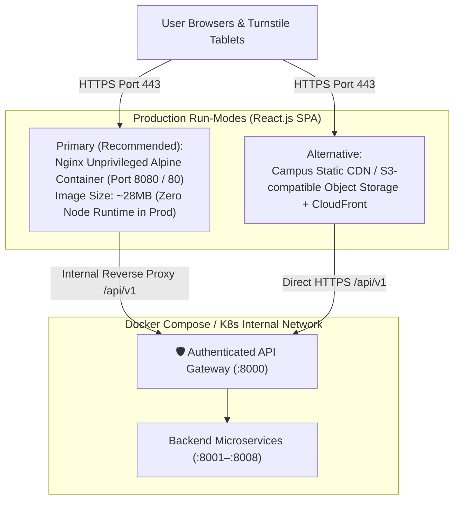

# 04. Deployment & DevOps Production Guide

**Version:** 1.0  
**Target Environments:** Local Docker Compose, Campus On-Premises Server, Cloud VM / Kubernetes  
**Status:** Deploy-Friendly Production Specification

---

## 1. Overview of Deployment Architecture

The **GymSlot** frontend is built as a **pure React.js Single-Page Application (Vite + React 18+)**. It is lightweight, stateless, and container-native, compiling to optimized static HTML, CSS, and JS:



---

## 2. Multi-Stage Production Dockerfile

The following multi-stage `Dockerfile` guarantees a minimal image footprint, high build-cache efficiency, and non-root execution:

```dockerfile
# ==============================================================================
# GymSlot Frontend — Multi-Stage Production Dockerfile (Nginx Alpine)
# ==============================================================================

# Stage 1: Dependency resolution and build
FROM node:20-alpine AS builder

WORKDIR /app

# Install build essentials
RUN apk add --no-cache libc6-compat

# Leverage Docker layer caching for node dependencies
COPY package.json package-lock.json* ./
RUN npm ci

# Copy application source code
COPY . .

# Build-time environment variable injection
ARG VITE_API_URL=/api/v1
ARG VITE_GOOGLE_CLIENT_ID
ARG VITE_CAMPUS_DOMAIN=srmap.edu.in
ENV VITE_API_URL=${VITE_API_URL}
ENV VITE_GOOGLE_CLIENT_ID=${VITE_GOOGLE_CLIENT_ID}
ENV VITE_CAMPUS_DOMAIN=${VITE_CAMPUS_DOMAIN}

# Build optimized production bundle
RUN npm run build

# ==============================================================================
# Stage 2: Production Web Server (Nginx Unprivileged Alpine)
# ==============================================================================
FROM nginx:alpine-slim AS runner

# Remove default nginx boilerplate
RUN rm -rf /etc/nginx/conf.d/* /usr/share/nginx/html/*

# Copy custom high-performance Nginx configuration
COPY nginx.conf /etc/nginx/conf.d/default.conf

# Copy compiled static assets from builder stage
COPY --from=builder /app/dist /usr/share/nginx/html

# Run as non-root unprivileged user for security compliance
USER nginx

# Expose standard unprivileged HTTP port
EXPOSE 8080

# Production Healthcheck
HEALTHCHECK --interval=15s --timeout=3s --retries=3 \
  CMD wget --quiet --tries=1 --spider http://localhost:8080/health || exit 1

CMD ["nginx", "-g", "daemon off;"]
```

---

## 3. Production Nginx Configuration (`nginx.conf`)

This configuration handles client-side SPA routing, Gzip/Brotli compression, cache optimization, and required camera permissions for the turnstile scanner:

```nginx
server {
    listen 8080;
    server_name localhost;
    root /usr/share/nginx/html;
    index index.html;

    # ── Security Headers ──────────────────────────────────────────────────────
    add_header X-Frame-Options "SAMEORIGIN" always;
    add_header X-Content-Type-Options "nosniff" always;
    add_header X-XSS-Protection "1; mode=block" always;
    add_header Referrer-Policy "strict-origin-when-cross-origin" always;
    
    # Required for turnstile camera access on mobile / desk tablets
    add_header Permissions-Policy "camera=(self)" always;

    # Content Security Policy (Locked down to local API and Google OAuth)
    add_header Content-Security-Policy "default-src 'self'; script-src 'self' 'unsafe-inline' https://accounts.google.com; style-src 'self' 'unsafe-inline' https://fonts.googleapis.com; font-src 'self' https://fonts.gstatic.com data:; img-src 'self' data: blob: https://*.amazonaws.com https://accounts.google.com; connect-src 'self' http://localhost:8000 https://accounts.google.com; frame-src https://accounts.google.com;" always;

    # ── Compression ──────────────────────────────────────────────────────────
    gzip on;
    gzip_vary on;
    gzip_proxied any;
    gzip_comp_level 6;
    gzip_types text/plain text/css text/xml application/json application/javascript application/rss+xml application/atom+xml image/svg+xml;

    # ── Static Asset Long-Term Caching ───────────────────────────────────────
    location ~* \.(?:css|js|woff2?|png|jpg|jpeg|gif|ico|svg|webp)$ {
        expires 1y;
        add_header Cache-Control "public, max-age=31536000, immutable";
        access_log off;
    }

    # ── PWA Service Worker & Manifest (Never aggressively cached) ────────────
    location = /sw.js {
        expires off;
        add_header Cache-Control "no-cache, no-store, must-revalidate";
    }
    location = /manifest.json {
        expires 1d;
        add_header Cache-Control "public, max-age=86400";
    }

    # ── Single-Page Application (SPA) Routing Fallback ───────────────────────
    location / {
        try_files $uri $uri/ /index.html;
    }

    # ── API Gateway Reverse Proxy (Local Docker / Monolithic Gateway) ─────────
    location /api/v1/ {
        proxy_pass http://api-gateway:8000/api/v1/;
        proxy_http_version 1.1;
        proxy_set_header Upgrade $http_upgrade;
        proxy_set_header Connection 'upgrade';
        proxy_set_header Host $host;
        proxy_set_header X-Real-IP $remote_addr;
        proxy_set_header X-Forwarded-For $proxy_add_x_forwarded_for;
        proxy_set_header X-Forwarded-Proto $scheme;
        proxy_cache_bypass $http_upgrade;
    }

    # ── Healthcheck Endpoint ─────────────────────────────────────────────────
    location = /health {
        access_log off;
        return 200 "healthy\n";
    }
}
```

---

## 4. Docker Compose Integration

The frontend service seamlessly attaches to the existing root [`docker-compose.yml`](../docker-compose.yml):

```yaml
  # ── Frontend Application ───────────────────────────────────────────────
  frontend:
    build:
      context: ./frontend
      dockerfile: Dockerfile
      args:
        VITE_API_URL: /api/v1
        VITE_GOOGLE_CLIENT_ID: ${GOOGLE_CLIENT_ID}
        VITE_CAMPUS_DOMAIN: ${ALLOWED_EMAIL_DOMAINS:-srmap.edu.in}
    container_name: gym-frontend
    restart: unless-stopped
    ports:
      - "3000:8080"
    depends_on:
      api-gateway:
        condition: service_healthy
    healthcheck:
      test: ["CMD", "wget", "--quiet", "--tries=1", "--spider", "http://localhost:8080/health"]
      interval: 15s
      timeout: 3s
      retries: 3
    environment:
      NODE_ENV: production
```

---

## 5. Environment Variables Specification

The frontend requires the following variables at build and run time:

### `.env.example`
```env
# ── API & Routing ─────────────────────────────────────────────────────────────
# Base path for backend REST API Gateway
VITE_API_URL=/api/v1

# ── Google OAuth 2.0 Credentials ──────────────────────────────────────────────
# Google Cloud Console Client ID configured for Web Applications
VITE_GOOGLE_CLIENT_ID=your-google-client-id.apps.googleusercontent.com

# Authorized college domain enforcement
VITE_CAMPUS_DOMAIN=srmap.edu.in

# ── Feature Flags & Config ────────────────────────────────────────────────────
# Enable PWA Add-to-Home-Screen installability
VITE_ENABLE_PWA=true

# Campus time zone lock
VITE_TIMEZONE=Asia/Kolkata
```

---

## 6. Gym Staff Scanner Camera Requirements (HTTPS Enforcement)

> [!IMPORTANT]
> Modern mobile and desktop browsers (iOS Safari, Android Chrome, Edge) **block camera access on non-secure HTTP connections**, with the sole exception of `localhost`.
> When deploying to campus servers or cloud environments, **HTTPS is mandatory** for the Gym Staff Scanner to operate.

### Production SSL / TLS Termination Options
1. **Nginx Reverse Proxy with Let's Encrypt Certbot:** Automatically provisions free SSL certificates for campus subdomains (e.g., `gym.srmap.edu.in`).
2. **Campus Cloud Load Balancer (AWS ALB / Cloudflare):** Terminate SSL at the edge and forward HTTP traffic to container port `8080`.

---

## 7. Progressive Web App (PWA) Installability

The web application supports Progressive Web App (PWA) installation for home screen access on mobile devices and desk tablets:

### `manifest.json`
```json
{
  "name": "GymSlot — SRM University-AP",
  "short_name": "GymSlot",
  "start_url": "/student/dashboard",
  "display": "standalone",
  "background_color": "#eeecea",
  "theme_color": "#2e4a3e",
  "icons": [
    {
      "src": "/assets/icon-192.png",
      "sizes": "192x192",
      "type": "image/png"
    },
    {
      "src": "/assets/icon-512.png",
      "sizes": "512x512",
      "type": "image/png"
    }
  ]
}
```

### Service Worker Caching & Security Strategy
> [!CAUTION]
> **Zero Offline QR Caching:** Do not cache QR codes or sensitive student records for offline use. Attendance validation requires authoritative, server-verified checks against live database records.

- **Static App Shell (`/`, CSS, Fonts, Images):** Cache-First with Stale-While-Revalidate updates.
- **API & Attendance Requests (`/api/v1/*`):** Strictly Network-Only. Excluded from all service worker caches to prevent replay attacks or stale verification states.
- **Service Worker (`sw.js`):** Employs `Cache-Control: no-cache, no-store, must-revalidate` so updates activate immediately across devices.

---

## 8. Continuous Integration & Deployment (CI/CD)

The automated deployment pipeline runs via GitHub Actions (`.github/workflows/frontend-deploy.yml`):

```yaml
name: Frontend Production CI/CD

on:
  push:
    branches: [ main ]
    paths:
      - 'frontend/**'
      - '.github/workflows/frontend-deploy.yml'

jobs:
  test-and-build:
    name: Lint, Test & Build Docker Image
    runs-on: ubuntu-latest

    steps:
      - name: Checkout Code
        uses: actions/checkout@v4

      - name: Setup Node.js 20
        uses: actions/setup-node@v4
        with:
          node-version: 20
          cache: 'npm'
          cache-dependency-path: frontend/package-lock.json

      - name: Install Dependencies
        run: |
          cd frontend
          npm ci

      - name: Run Type Checking & Linter
        run: |
          cd frontend
          npm run typecheck
          npm run lint

      - name: Run Unit Tests
        run: |
          cd frontend
          npm run test:run

      - name: Set up Docker Buildx
        uses: docker/setup-buildx-action@v3

      - name: Build Production Docker Image
        uses: docker/build-push-action@v5
        with:
          context: ./frontend
          push: false
          tags: gymslot-frontend:latest
          build-args: |
            VITE_API_URL=/api/v1
            VITE_GOOGLE_CLIENT_ID=${{ secrets.GOOGLE_CLIENT_ID }}
            VITE_CAMPUS_DOMAIN=srmap.edu.in
```

---

## 9. Performance & Core Web Vitals Targets

The frontend architecture is tuned to achieve top-tier performance benchmarks:
- **Largest Contentful Paint (LCP):** `< 1.2s` (optimized hero font preloading, zero heavy blocking scripts).
- **First Input Delay (FID) / Interaction to Next Paint (INP):** `< 50ms` (lightweight state updates, headless tables).
- **Cumulative Layout Shift (CLS):** `0.00` (pre-allocated card dimensions, `tabular-nums` for dynamic digits).
- **Bundle Footprint:** Initial JavaScript payload `< 140KB` gzipped.
