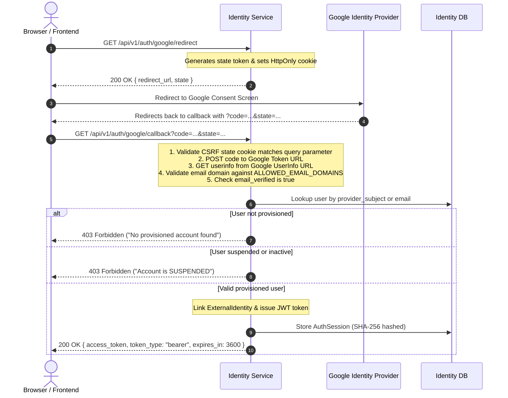

# GymSlot — Identity Service

**Version:** 1.0.0  
**Service Port:** `8001`  
**Database:** PostgreSQL (`gym_identity`)  
**Technology Stack:** FastAPI, SQLAlchemy 2.0 (Async), Asyncpg, Pydantic v2, Jose (JWT), Alembic, Pytest

---

## 1. Overview & Service Scope

The **Identity Service** is the authoritative authentication and authorization service for the GymSlot platform at SRM University-AP.

### Core Responsibilities
- **Google OAuth 2.0 / OpenID Connect Authentication**: Authenticates students and staff with their official college accounts.
- **Institutional Domain Enforcement**: Restricts sign-in strictly to allowed institutional email domains (e.g., `@srmap.edu.in`).
- **Account Provisioning Matching**: Requires accounts to be provisioned by administrators; Google sign-in securely links the verified external identity to the provisioned record.
- **JWT Issuance & Verification**: Issues short-lived, signed JSON Web Tokens for downstream service authentication via the API Gateway.
- **Server-Side Session Management**: Tracks and revokes server-side `auth_sessions` with cryptographically hashed tokens.
- **Role-Based Access Control (RBAC)**: Manages and enforces permissions for `STUDENT`, `TRAINER`, `ADMIN`, and `SUPER_ADMIN`.
- **Database Isolation**: Owns all data in `gym_identity`; other microservices never access this database directly.

---

## 2. Architecture & File Structure

```text
services/identity-service/
├── app/
│   ├── api/
│   │   ├── __init__.py           # Re-exports all route handlers
│   │   ├── auth.py               # Google OAuth & session endpoints
│   │   ├── deps.py               # FastAPI dependencies (JWT, RBAC guards, DB)
│   │   ├── roles.py              # Role listing endpoints
│   │   └── users.py              # User provisioning & admin management
│   ├── models/
│   │   ├── __init__.py           # Model discovery for Alembic migrations
│   │   ├── base.py               # TimestampMixin, uuid_pk, DeclarativeBase
│   │   ├── role.py               # Role & UserRole models
│   │   └── user.py               # User, ExternalIdentity, AuthSession models
│   ├── repositories/
│   │   ├── __init__.py           # Re-exports UserRepository & RoleRepository
│   │   └── user_repository.py    # Database query abstraction layer
│   ├── schemas/
│   │   ├── __init__.py           # Pydantic schemas export
│   │   ├── auth.py               # OAuth & Token schemas
│   │   └── user.py               # User & Role read/create/update models
│   ├── services/
│   │   ├── __init__.py
│   │   ├── auth_service.py       # Google OAuth flow & JWT encoding/decoding
│   │   └── user_service.py       # Business logic for user & role management
│   ├── config.py                 # Pydantic Settings & environment config
│   ├── database.py               # Async engine, sessionmaker, and DB dependency
│   └── main.py                   # FastAPI app factory, lifespan, CORS & routers
├── migrations/
│   ├── versions/
│   │   └── 0001_initial_schema.py# Full initial schema migration
│   ├── env.py                    # Async Alembic configuration
│   └── script.py.mako
├── tests/
│   ├── conftest.py               # Pytest async fixtures (in-memory SQLite)
│   ├── test_api_endpoints.py     # HTTP integration tests & RBAC checks
│   ├── test_auth_service.py      # Unit tests for JWT & domain validation
│   └── test_user_service.py      # Unit tests for User & Role services
├── .env.example                  # Environment configuration template
├── alembic.ini                   # Alembic configuration file
├── Dockerfile                    # Multi-stage production container definition
└── requirements.txt              # Production and testing dependencies
```

---

## 3. Database Schema (`gym_identity`)

Each service owns its isolated database. The Identity Service owns 5 tables in `gym_identity`:

```text
  ┌───────────────┐          1:N          ┌───────────────────────┐
  │     users     │──────────────────────<│  external_identities  │
  └───────┬───────┘                       └───────────────────────┘
          │
          │ 1:N                           ┌───────────────────────┐
          ├──────────────────────────────<│     auth_sessions     │
          │                               └───────────────────────┘
          │ 1:N
  ┌───────┴───────┐          N:1          ┌───────────────────────┐
  │  user_roles   │>──────────────────────│         roles         │
  └───────────────┘                       └───────────────────────┘
```

### Table Definitions

#### `users`
| Column | Type | Constraints | Description |
|---|---|---|---|
| `id` | `UUID` | Primary Key | Standard UUID identifier |
| `email` | `VARCHAR(320)` | Unique, Not Null | Normalised lowercase college email |
| `email_verified_at`| `TIMESTAMPTZ` | Nullable | Timestamp when Google verified the address |
| `status` | `VARCHAR(20)` | Not Null, Default `PENDING` | `PENDING`, `ACTIVE`, `SUSPENDED`, `INACTIVE` |
| `created_at` | `TIMESTAMPTZ` | Not Null, Server Default Now | Account provisioning timestamp |
| `updated_at` | `TIMESTAMPTZ` | Not Null, Server Default Now | Last update timestamp |

*Index:* `ix_users_email_lower` on `email` (Unique).

#### `external_identities`
| Column | Type | Constraints | Description |
|---|---|---|---|
| `id` | `UUID` | Primary Key | Record identifier |
| `user_id` | `UUID` | Foreign Key (`users.id` ON DELETE CASCADE) | Linked provisioned user |
| `provider` | `VARCHAR(50)` | Not Null | Identity provider name (e.g. `google`) |
| `provider_subject`| `VARCHAR(256)` | Not Null | Google's immutable user ID (`sub`) |
| `created_at` | `TIMESTAMPTZ` | Not Null | Record creation time |
| `updated_at` | `TIMESTAMPTZ` | Not Null | Record update time |

*Constraints:* Unique constraint `uq_external_provider_sub` on `(provider, provider_subject)`.

#### `roles`
| Column | Type | Constraints | Description |
|---|---|---|---|
| `id` | `UUID` | Primary Key | Role identifier |
| `name` | `VARCHAR(50)` | Unique, Not Null | `STUDENT`, `TRAINER`, `ADMIN`, `SUPER_ADMIN` |
| `created_at` | `TIMESTAMPTZ` | Not Null | Creation timestamp |
| `updated_at` | `TIMESTAMPTZ` | Not Null | Update timestamp |

#### `user_roles`
| Column | Type | Constraints | Description |
|---|---|---|---|
| `user_id` | `UUID` | Composite PK, FK (`users.id` ON DELETE CASCADE) | Assigned user |
| `role_id` | `UUID` | Composite PK, FK (`roles.id` ON DELETE CASCADE) | Assigned role |
| `assigned_by` | `UUID` | Nullable | Admin user ID who granted the role |
| `assigned_at` | `TIMESTAMPTZ` | Not Null | Assignment timestamp |

#### `auth_sessions`
| Column | Type | Constraints | Description |
|---|---|---|---|
| `id` | `UUID` | Primary Key | Session identifier |
| `user_id` | `UUID` | Foreign Key (`users.id` ON DELETE CASCADE) | User owning the session |
| `session_token_hash`| `VARCHAR(256)` | Unique, Not Null | SHA-256 hash of opaque session token |
| `expires_at` | `TIMESTAMPTZ` | Not Null | Session expiration timestamp |
| `revoked_at` | `TIMESTAMPTZ` | Nullable | Soft-revocation timestamp (set on logout) |
| `created_at` | `TIMESTAMPTZ` | Not Null | Session creation timestamp |

---

## 4. Authentication & Security Architecture

### Google OAuth 2.0 Flow



### JWT Structure
Tokens are signed with `HS256` using the application `JWT_SECRET`. Claims include:
```json
{
  "sub": "3fa85f64-5717-4562-b3fc-2c963f66afa6",
  "email": "student.name@srmap.edu.in",
  "roles": ["STUDENT"],
  "status": "ACTIVE",
  "iat": 1798450000,
  "exp": 1798453600
}
```

### Role-Based Access Control (RBAC) Matrix

| Endpoint | Method | Required Role | Description |
|---|---|---|---|
| `/health` | `GET` | Public | Service health & liveness check |
| `/api/v1/auth/google/redirect` | `GET` | Public | Initiate Google OAuth login |
| `/api/v1/auth/google/callback` | `GET` | Public | Handle Google OAuth code callback |
| `/api/v1/auth/me` | `GET` | Authenticated | Fetch current user identity & roles |
| `/api/v1/auth/logout` | `POST` | Authenticated | Revoke all active sessions for caller |
| `/api/v1/roles/` | `GET` | Authenticated | List all existing roles |
| `/api/v1/users/` | `POST` | `ADMIN`, `SUPER_ADMIN` | Provision a new user account |
| `/api/v1/users/` | `GET` | `ADMIN`, `SUPER_ADMIN` | Paginated listing of users |
| `/api/v1/users/{id}` | `GET` | `ADMIN`, `SUPER_ADMIN` | Retrieve user details |
| `/api/v1/users/{id}` | `PATCH` | `ADMIN`, `SUPER_ADMIN` | Update user status or email |
| `/api/v1/users/{id}/roles` | `POST` | `SUPER_ADMIN` | Assign a role to a user |
| `/api/v1/users/{id}/roles/{role}` | `DELETE` | `SUPER_ADMIN` | Revoke a role from a user |

---

## 5. API Reference

### 1. Authentication Endpoints

#### Initiate Google OAuth
- **Route:** `GET /api/v1/auth/google/redirect`
- **Response:** `200 OK`
```json
{
  "redirect_url": "https://accounts.google.com/o/oauth2/v2/auth?client_id=...&state=...",
  "state": "random-csrf-token"
}
```
*Sets `oauth_state` HttpOnly cookie.*

#### Google Callback
- **Route:** `GET /api/v1/auth/google/callback?code={code}&state={state}`
- **Response:** `200 OK`
```json
{
  "access_token": "eyJhbGciOiJIUzI1NiIsInR5cCI6IkpXVCJ9...",
  "token_type": "bearer",
  "expires_in": 3600
}
```

#### Get Current User Profile
- **Route:** `GET /api/v1/auth/me`
- **Header:** `Authorization: Bearer <token>`
- **Response:** `200 OK`
```json
{
  "id": "7662cbfb-88a6-4c4f-bf7e-b9b56f87498c",
  "email": "student@srmap.edu.in",
  "status": "ACTIVE",
  "email_verified_at": "2026-10-28T10:45:00Z",
  "created_at": "2026-10-28T10:00:00Z",
  "updated_at": "2026-10-28T10:45:00Z",
  "roles": [
    {
      "id": "e44d57c1-0c58-450a-8d39-658b14e6e6dc",
      "name": "STUDENT"
    }
  ]
}
```

#### Logout
- **Route:** `POST /api/v1/auth/logout`
- **Header:** `Authorization: Bearer <token>`
- **Response:** `204 No Content`

---

### 2. User Management Endpoints (Admin Only)

#### Provision User
- **Route:** `POST /api/v1/users/`
- **Header:** `Authorization: Bearer <admin_token>`
- **Request Body:**
```json
{
  "email": "new.student@srmap.edu.in",
  "status": "PENDING"
}
```
- **Response:** `201 Created`

#### List Users
- **Route:** `GET /api/v1/users/?skip=0&limit=100`
- **Response:** `200 OK` (Array of user objects)

#### Update User
- **Route:** `PATCH /api/v1/users/{user_id}`
- **Request Body:**
```json
{
  "status": "ACTIVE"
}
```
- **Response:** `200 OK`

#### Assign Role (Super Admin Only)
- **Route:** `POST /api/v1/users/{user_id}/roles`
- **Header:** `Authorization: Bearer <super_admin_token>`
- **Request Body:**
```json
{
  "role_name": "TRAINER"
}
```
- **Response:** `201 Created`

#### Revoke Role (Super Admin Only)
- **Route:** `DELETE /api/v1/users/{user_id}/roles/TRAINER`
- **Response:** `204 No Content`

---

## 6. Local Development & Testing

### Running Tests
The test suite uses an in-memory SQLite database via `aiosqlite` and requires no external services:

```bash
# From services/identity-service
python -m pytest tests/ -v
```

### Test Coverage (19 automated tests):
1. **API Endpoints (`tests/test_api_endpoints.py`)**:
   - `/health` liveness probe.
   - `401 Unauthorized` on unauthenticated protected routes.
   - `/api/v1/roles/` list retrieval.
   - `403 Forbidden` when non-admins attempt to provision users.
   - `201 Created` when admins provision users.
   - Google redirect URL and CSRF cookie issuance.
   - `/api/v1/auth/me` identity resolution.
   - `/api/v1/auth/logout` session invalidation.
2. **Auth Service (`tests/test_auth_service.py`)**:
   - Redirect URL generation with query parameters.
   - Institutional domain restriction logic (`@srmap.edu.in`).
   - Rejection of unauthorized domains (`@gmail.com`).
   - JWT encoding and round-trip claim decoding.
   - Tampered token rejection.
   - Opaque high-entropy session token generation.
3. **User Service (`tests/test_user_service.py`)**:
   - Seed default roles and verify idempotency.
   - User creation with automatic email normalization to lowercase.
   - Rejection of duplicate user emails.
   - User lookup and `404 Not Found` handling.
   - User email and status updates with conflict checks.
   - Role assignment, idempotency verification, and role revocation.

---

## 7. Database Migrations

Alembic is configured for asynchronous migrations using `asyncpg` and SQLAlchemy's async engine:

```bash
# Run all pending migrations
alembic upgrade head

# Create a new autogenerated migration after model updates
alembic revision --autogenerate -m "description_of_changes"

# Rollback one migration step
alembic downgrade -1
```

---

## 8. Docker & Production Deployment

The service includes a multi-stage Dockerfile optimized for small image size and security:
- **Build Stage**: Installs dependencies into a isolated directory prefix.
- **Runtime Stage**: Uses `python:3.12-slim`, runs as a non-privileged `gymslot` system user, and configures a built-in container health check.

```bash
# Build Docker image
docker build -t gymslot-identity-service:latest .

# Run Docker container
docker run -d \
  --name gymslot-identity \
  -p 8001:8001 \
  --env-file .env \
  gymslot-identity-service:latest
```
